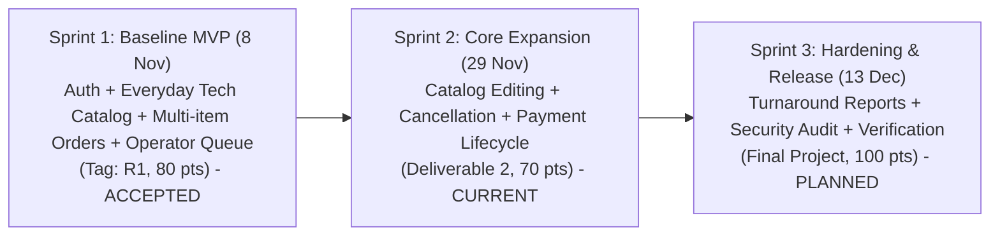

# Three-Sprint Development Plan

---

## 1. Development Lifecycle Strategy

The TechTent project follows the course's three-sprint progressive delivery model. Each sprint delivers a deployable, tested increment governed by engineering contracts, peer-reviewed pull requests, automated test suites, and continuous deployment to Google Cloud Run.

---

## 2. Sprint Breakdown & Milestones

### 2.1 Sprint 1: Baseline Architecture & Deployable Vertical Slice
- **Checkpoint**: Deliverable 1 — Due 8 November 2026 (80 project points)
- **Sprint Goal**: Prove team capability to design, engineer, and release a working full-stack slice with authentication, everyday tech catalog browsing, authoritative order computation, atomic persistence, and operator order management.
- **Included Features**:
  - `F-01`: User Authentication & Session Control (`CUSTOMER`, `OPERATOR`, `ADMIN`).
  - `F-02`: Product Catalog Browsing with real-time stock indication (Smartphones, Tablets, TVs, Keyboards, Chargers).
  - `F-03`: Multi-item Order Creation with server-authoritative calculations and atomic inventory reservation.
  - `F-04`: Customer Order Details & History with historic price preservation.
  - `F-05`: Operator Order Queue & Processing (`PENDING` ➔ `ACCEPTED` / `REJECTED`).
- **Achieved Outcome**:
  - Released on `main` under tag `R1` (`9ff3341`).
  - Containerized and continuously deployed to GCP Cloud Run in Lab 5 (`lab5`, `e17f136`).
  - 182 distinct automated unit, integration, and component tests passing.

### 2.2 Sprint 2: Core Domain Expansion & Order Lifecycle (Current Sprint)
- **Checkpoint**: Deliverable 2 — Due 29 November 2026 (70 project points)
- **Sprint Goal**: Extend the core business workflow into administrative inventory control, customer order cancellation with automated stock restoral, and a decoupled simulated payment state machine.
- **Included Features**:
  - `F-06`: Catalog Management & Stock Restocking (CRUD for electronics products by Operators/Admins).
  - `F-07`: Customer Order Cancellation (cancelling `PENDING` orders with automated atomic stock restoral).
  - `F-08`: Simulated Payment State Machine (`UNPAID`, `PAID`, `REFUNDED`, `VOID`) and extended fulfillment states (`ACCEPTED` ➔ `PACKED` ➔ `SHIPPED`).
- **Required Outcomes & Deliverables**:
  - Complete engineering contracts and STS matrices before implementation.
  - Substantially complete application integrated on `sprint-2-staging` and deployed to GCP Cloud Run.
  - Continuous regression test suite execution (verifying zero regressions on Sprint 1 vertical slice).
  - Traceable PR chains and peer review evidence.
  - Self-contained PDF compiled for Deliverable 2 submission.

### 2.3 Sprint 3: Completion, Reporting & Product Hardening (Deferred Scope)
- **Checkpoint**: Final Project Delivery — Due 13 December 2026 (100 project points)
- **Sprint Goal**: Finalize all remaining edge cases, implement executive sales summaries and operational turnaround analytics, harden security and rate limiting, and produce the final verified release.
- **Included Features**:
  - `F-09`: Sales Summaries & Operational Turnaround Metrics.
  - `F-10`: Comprehensive System Hardening & Boundary Polishing.
- **Required Outcomes & Deliverables**:
  - 100% baseline requirement coverage with passing test suite.
  - Final PDF report, live cloud deployment URL (Lab 5), and 10-minute demo video.

---

## 3. Team Responsibilities & Ownership Matrix (Sprint 2)

| Feature / Responsibility | Primary Owner | Reviewer / Secondary Owner | Target Completion Date |
|---|---|---|---|
| **`S2-00/Docs` Documentation & Contracts Baseline** | PAKATO | Joey-pku | 22 Nov 2026 |
| **`F-06/CatalogManagement` (API & UI)** | PAKATO (API) | Joey-pku (UI) | 25 Nov 2026 |
| **`F-07/CustomerCancellation` (Transaction & Modal)** | Joey-pku (Backend) | PAKATO (Frontend) | 26 Nov 2026 |
| **`F-08/PaymentStateMachine` (Lifecycle & Modals)** | PAKATO (State Machine) | Joey-pku (Modal UI) | 27 Nov 2026 |
| **`sprint-2-staging` Integration & GCP Deploy** | PAKATO & Joey-pku | Peer Verified | 28 Nov 2026 |
| **Deliverable 2 Report Compilation** | PAKATO & Joey-pku | Both | 29 Nov 2026 |

---

## 4. Team Responsibilities & Ownership Matrix (Sprint 3)

| Feature / Responsibility | Primary Owner | Reviewer / Secondary Owner | Target Completion Date |
|---|---|---|---|
| **`S3-00/Docs` Documentation & Contracts Baseline** | PAKATO | Joey-pku | 23 Nov 2026 |
| **`F-09/OperationalReports` (API & UI)** | PAKATO (API) | Joey-pku (UI) | 26 Nov 2026 |
| **`F-10/ProductionHardening` (Rate Limit & Probes)** | Joey-pku (Security) | PAKATO (Testing) | 27 Nov 2026 |
| **`sprint-3-staging` Integration & GCP Deploy** | PAKATO & Joey-pku | Peer Verified | 28 Nov 2026 |
| **Deliverable 2 Submission & PDF Compilation** | PAKATO & Joey-pku | Both | 29 Nov 2026 |
| **Final Delivery Submission, Video & PDF** | PAKATO & Joey-pku | Both | 13 Dec 2026 |
