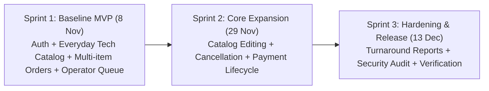

# Three-Sprint Development Plan
## CPE 334 — TechTent Everyday Electronics Ordering System
**Document Version**: 1.1.0 | **Date**: November 2026

### Team Information
> **Fill in the student details below:**
- **Student 1**: `[FILL IN: Student 1 Full Name — Student ID]`
- **Student 2**: `[FILL IN: Student 2 Full Name — Student ID]`
- **Repository URL**: `https://github.com/PAKATO123/CPE-334-E-Commerce-or-Ordering-System.git`
- **Submitted Release Tag / Commit**: `[FILL IN: Release Tag / Commit SHA]`

---

## 1. Development Lifecycle Strategy

The TechTent project follows the course's three-sprint progressive delivery model. Each sprint delivers a deployable, tested increment governed by engineering contracts, peer-reviewed pull requests, and automated test suites.

---

## 2. Sprint Breakdown & Milestones

### 2.1 Sprint 1: Baseline Architecture & Deployable Vertical Slice
- **Checkpoint**: Deliverable 1 — Due 8 November 2026 (80 project points)
- **Sprint Goal**: Prove team capability to design, engineer, and release a working full-stack slice with authentication, everyday tech catalog browsing, authoritative order computation, atomic persistence, and operator order management.
- **Included Features**:
  - `F-01`: User Authentication & Session Control (`CUSTOMER`, `OPERATOR`, `ADMIN`).
  - `F-02`: Product Catalog Browsing with real-time stock indication (Smartphones, Tablets, TVs, Keyboards, Chargers).
  - `F-03`: Multi-item Order Creation with server-authoritative calculations and atomic inventory reservation.
  - `F-04`: Customer Order Details & History with historic price preservation.
  - `F-05`: Operator Order Queue & Processing (`PENDING` ➔ `ACCEPTED` / `REJECTED`).
- **Required Outcomes & Deliverables**:
  - Runnable increment on `main` with reproducible local setup.
  - Passing automated test suites (API, persistence, access restrictions, UI).
  - Traceable GitHub Issues, feature branches, and reviewed PRs.
  - Parts A–F documented and submitted as a self-contained PDF.

### 2.2 Sprint 2: Core Domain Expansion & Order Lifecycle
- **Checkpoint**: Deliverable 2 — Due 29 November 2026 (70 project points)
- **Sprint Goal**: Extend the core business workflow into administrative inventory control, customer order cancellation, and multi-stage payment transitions.
- **Included Features**:
  - `F-06`: Catalog Management & Stock Restocking (CRUD for electronics products by Operators/Admins).
  - `F-07`: Customer Order Cancellation (cancelling pending orders with automated stock restoral).
  - `F-08`: Simulated Payment State Machine (`PENDING_PAYMENT`, `PAID`, `REFUNDED`).
- **Required Outcomes & Deliverables**:
  - Substantially complete application.
  - Continuous regression test suite execution.
  - Peer review evidence across all new feature PRs.

### 2.3 Sprint 3: Completion, Reporting & Product Hardening
- **Checkpoint**: Final Project Delivery — Due 13 December 2026 (100 project points)
- **Sprint Goal**: Finalize all remaining edge cases, implement executive sales summaries, harden security and error recovery, and produce the final verified release.
- **Included Features**:
  - `F-09`: Sales Summaries & Operational Turnaround Metrics (daily sales, inventory velocity, queue processing duration).
  - `F-10`: Comprehensive System Hardening & Boundary Polishing.
- **Required Outcomes & Deliverables**:
  - 100% baseline requirement coverage with passing test suite.
  - Final PDF report, live cloud deployment URL (Lab 5), and 10-minute demo video.

---

## 3. Sprint 1 Scope Feasibility Assessment

The selected Sprint 1 scope satisfies all requirements of Section 6 of the course specification while remaining realistically deliverable within the timeframe:
1. **Vertical Completeness**: Traverses UI ➔ API ➔ Database.
2. **Clear Boundaries**: Re-uses the battle-tested session auth pattern from prior labs, focuses engineering energy on authoritative pricing algorithms and atomic transactions.
3. **No External Blockers**: Eliminates external payment APIs or shipping third parties, avoiding external outage dependencies.
