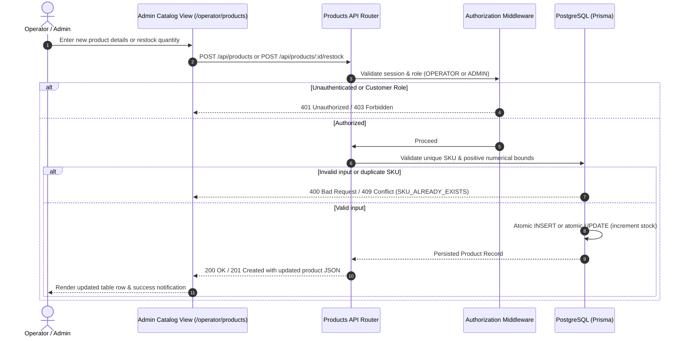
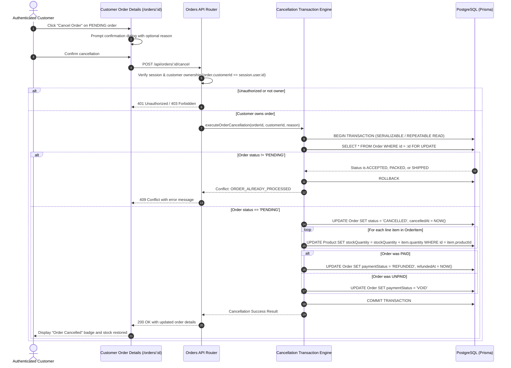
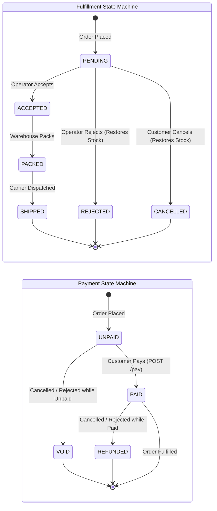

# Sprint 2 Feature Engineering Contracts

---

## 1. Feature Contract: F-06 Catalog Curation & Inventory Restocking

### 1.1 Overview & Requirements Linkage
- **Linked Requirements**: FR-11, BR-07, NFR-01, NFR-02
- **Allocated Sprint**: Sprint 2
- **Feature Owner**: PAKATO (Backend / API), Joey-pku (Frontend / UI)
- **Description**: Provides an administrative management interface for store Operators and Administrators to create new electronics products, update existing product specifications (title, category, description, price), toggle product active/discontinued status, and restock warehouse inventory units with atomic increment semantics.

### 1.2 Feature SDS & Workflow


### 1.3 Architectural & Layer Impact
- **Presentation Tier**: Add dedicated Operator/Admin view `/operator/products` (ProductManagementPage) with:
  - Product list table with search/category filter, live stock counts, active toggle, "Edit", and "Restock" action buttons.
  - "Add Product" modal with validated inputs (SKU, Name, Category dropdown, Price, Initial Stock, Description).
  - Quick-restock numeric modal triggering atomic restock calls.
- **Application / API Tier**: Extend `server/src/routes/products.ts` with:
  - `POST /api/products`: Create new device (Protected: `requireRole(['OPERATOR', 'ADMIN'])`).
  - `PATCH /api/products/:id`: Update device metadata/price/status (Protected: `requireRole(['OPERATOR', 'ADMIN'])`).
  - `POST /api/products/:id/restock`: Atomic inventory increment (Protected: `requireRole(['OPERATOR', 'ADMIN'])`).
- **Persistence Tier**: Existing `Product` model in Prisma already contains `sku`, `name`, `category`, `description`, `price`, `stockQuantity`, `isActive`. No structural schema alterations required for F-06; use atomic `{ stockQuantity: { increment: quantity } }`.

### 1.4 API Endpoint Specifications

#### POST /api/products
- **Access**: Authenticated `OPERATOR` or `ADMIN`.
- **Request Body**:
  ```json
  {
    "sku": "CHG-WIRELESS-15W",
    "name": "15W Magnetic Wireless Charging Pad",
    "category": "Chargers & Power",
    "description": "Qi-certified fast magnetic wireless charger with aluminum base.",
    "price": 39.99,
    "stockQuantity": 20
  }
  ```
- **Validation Rules**:
  - `sku`: String, non-empty, trimmed, alphanumeric with hyphens, unique in DB.
  - `name`: String, non-empty, min 3 chars, max 100 chars.
  - `category`: Must be one of `['Smartphones', 'Tablets', 'Smart TVs', 'Keyboards', 'Chargers & Power']`.
  - `price`: Number, strictly positive (`> 0.00`).
  - `stockQuantity`: Integer, non-negative (`>= 0`).
- **Success Response (`201 Created`)**:
  ```json
  {
    "data": {
      "id": 7,
      "sku": "CHG-WIRELESS-15W",
      "name": "15W Magnetic Wireless Charging Pad",
      "category": "Chargers & Power",
      "description": "Qi-certified fast magnetic wireless charger with aluminum base.",
      "price": "39.99",
      "stockQuantity": 20,
      "isActive": true,
      "createdAt": "2026-11-22T10:00:00.000Z",
      "updatedAt": "2026-11-22T10:00:00.000Z"
    }
  }
  ```
- **Error Responses**:
  - `400 Bad Request`: `{ "error": { "code": "VALIDATION_ERROR", "message": "Price must be a positive number greater than 0." } }`
  - `401 Unauthorized`: `{ "error": { "code": "UNAUTHORIZED", "message": "Authentication required." } }`
  - `403 Forbidden`: `{ "error": { "code": "FORBIDDEN", "message": "Operator or Admin authorization required." } }`
  - `409 Conflict`: `{ "error": { "code": "SKU_ALREADY_EXISTS", "message": "A product with SKU 'CHG-WIRELESS-15W' already exists." } }`

#### PATCH /api/products/:id
- **Access**: Authenticated `OPERATOR` or `ADMIN`.
- **Request Body** (Partial updates supported):
  ```json
  {
    "name": "Flagship Pro Smartphone 256GB - Midnight Black",
    "price": 849.00,
    "isActive": false
  }
  ```
- **Success Response (`200 OK`)**: Returns updated product object.
- **Error Responses**:
  - `400 Bad Request`: If invalid field values or negative price provided.
  - `404 Not Found`: `{ "error": { "code": "PRODUCT_NOT_FOUND", "message": "Product ID 999 does not exist." } }`

#### POST /api/products/:id/restock
- **Access**: Authenticated `OPERATOR` or `ADMIN`.
- **Request Body**:
  ```json
  {
    "quantity": 15
  }
  ```
- **Validation**: `quantity` must be a positive integer (`>= 1`).
- **Success Response (`200 OK`)**:
  ```json
  {
    "data": {
      "id": 1,
      "sku": "PHON-PRO-256",
      "name": "Flagship Pro Smartphone 256GB",
      "previousStock": 10,
      "restockedAmount": 15,
      "newStock": 25
    }
  }
  ```

### 1.5 Acceptance Criteria (F-06)
- **AC-CAT-MGMT-01**: An Operator or Admin can create a new electronic product with valid SKU, name, category, positive price, and non-negative initial stock.
- **AC-CAT-MGMT-02**: Attempting to create a product with an already existing SKU is rejected with `409 Conflict` (`SKU_ALREADY_EXISTS`).
- **AC-CAT-MGMT-03**: Attempting to set a zero or negative price or negative stock quantity is rejected with `400 Bad Request`.
- **AC-CAT-MGMT-04**: An Operator or Admin can update existing product details (name, category, price, description) and toggle active/inactive status (`isActive`).
- **AC-CAT-MGMT-05**: Calling the restock endpoint with a positive integer atomically increments the product's `stockQuantity` in PostgreSQL.
- **AC-CAT-MGMT-06**: Customers and unauthenticated users attempting to invoke product creation, update, or restock endpoints are rejected with `401 Unauthorized` or `403 Forbidden`.

### 1.6 Software Test Specification (F-06 STS)
- **TEST-CAT-M01** (API / Integration): Post valid new product payload as Admin ➔ Verify `201 Created` and database persistence.
- **TEST-CAT-M02** (API / Integration): Post new product with duplicate SKU `PHON-PRO-256` ➔ Verify `409 Conflict` (`SKU_ALREADY_EXISTS`).
- **TEST-CAT-M03** (Unit / API): Post new product with negative price `-10.00` ➔ Verify `400 Bad Request`.
- **TEST-CAT-M04** (API / Integration): Patch product #1 setting `isActive: false` ➔ Verify product is excluded from `GET /api/products` (public catalog) but historical orders remain intact.
- **TEST-CAT-M05** (API / Concurrency): Execute restock of +10 units on device with current stock 5 ➔ Verify returned stock is 15 and database reflects 15.
- **TEST-CAT-M06** (Security / Integration): Customer session attempts `POST /api/products` ➔ Verify `403 Forbidden`.

### 1.7 Definition of Done (F-06)
1. Complete CRUD and restock API endpoints implemented and secured with role verification.
2. Responsive React frontend UI mounted under `/operator/products` with accessible forms and confirmation modals.
3. 100% passing automated test suite covering creation, validation boundaries, SKU collisions, atomic restocking, and role restrictions.
4. Peer-reviewed PR merged from `F-06/CatalogManagement` into `sprint-2-staging`.

---

## 2. Feature Contract: F-07 Customer Order Cancellation & Stock Restoral

### 2.1 Overview & Requirements Linkage
- **Linked Requirements**: FR-12, BR-08, BR-04, NFR-02
- **Allocated Sprint**: Sprint 2
- **Feature Owner**: Joey-pku (Backend & Transaction), PAKATO (Frontend & Receipt UI)
- **Description**: Enables authenticated customers to cancel an order that they placed as long as the order is still in `PENDING` status. The system atomically transitions order status to `CANCELLED`, records cancellation timestamp and reason, and restores all reserved line-item stock quantities back to PostgreSQL within a single isolated transaction.

### 2.2 Feature SDS & Workflow


### 2.3 Architectural & Layer Impact
- **Presentation Tier**:
  - Update `OrderDetailPage.tsx`: Render a prominent "Cancel Order" button if and only if `order.status === 'PENDING'`.
  - Include confirmation modal explaining that cancellation releases reserved items.
  - Display "CANCELLED" status badge with red badge styling and display `cancelledAt` timestamp and cancellation reason.
- **Application / API Tier**:
  - Add `POST /api/orders/:id/cancel` in `server/src/routes/orders.ts`.
  - Implement `cancelCustomerOrder` service in `server/src/services/cancellation.ts` using `prisma.$transaction`.
  - Enforce ownership check (`order.customerId === req.session.userId`).
  - Enforce status constraint: only `PENDING` orders can be cancelled.
- **Persistence Tier**:
  - Add optional columns to `Order` in `schema.prisma`:
    - `cancelledAt DateTime?`
    - `cancellationReason String?`
    - `paymentStatus String @default("UNPAID")`
    - `refundedAt DateTime?`

### 2.4 API Endpoint Specifications

#### POST /api/orders/:id/cancel
- **Access**: Authenticated `CUSTOMER` (Order Owner) or `ADMIN`.
- **Request Body**:
  ```json
  {
    "reason": "Accidental double order placed by mistake."
  }
  ```
- **Validation**:
  - `:id` must be a valid positive integer.
  - `reason`: Optional string, max 255 characters.
- **Success Response (`200 OK`)**:
  ```json
  {
    "data": {
      "id": 42,
      "orderNumber": "ORD-20261122-0042",
      "status": "CANCELLED",
      "paymentStatus": "VOID",
      "totalAmount": "899.00",
      "cancelledAt": "2026-11-22T10:15:30.000Z",
      "cancellationReason": "Accidental double order placed by mistake.",
      "items": [
        {
          "productId": 1,
          "productName": "Flagship Pro Smartphone 256GB",
          "quantity": 1,
          "unitPrice": "899.00",
          "subtotal": "899.00",
          "restoredStock": true
        }
      ]
    }
  }
  ```
- **Error Responses**:
  - `400 Bad Request`: `{ "error": { "code": "INVALID_ORDER_ID", "message": "Order ID must be an integer." } }`
  - `401 Unauthorized`: `{ "error": { "code": "UNAUTHORIZED", "message": "Authentication required." } }`
  - `403 Forbidden`: `{ "error": { "code": "FORBIDDEN", "message": "You cannot cancel an order belonging to another customer." } }`
  - `404 Not Found`: `{ "error": { "code": "ORDER_NOT_FOUND", "message": "Order does not exist." } }`
  - `409 Conflict`: `{ "error": { "code": "ORDER_ALREADY_PROCESSED", "message": "Cannot cancel order: current status is 'ACCEPTED'." } }`

### 2.5 Acceptance Criteria (F-07)
- **AC-ORD-CAN-01**: A customer can cancel their own order while it is in `PENDING` status.
- **AC-ORD-CAN-02**: Upon cancellation, the order status transitions to `CANCELLED`, `cancelledAt` is recorded, and reserved stock for all line items is atomically restored in PostgreSQL.
- **AC-ORD-CAN-03**: If an order has already transitioned to `ACCEPTED`, `PACKED`, or `SHIPPED`, a cancellation attempt returns `409 Conflict` and stock remains untouched.
- **AC-ORD-CAN-04**: A customer attempting to cancel another customer's order is rejected with `403 Forbidden` (or `404 Not Found`).
- **AC-ORD-CAN-05**: If an order was already paid (`paymentStatus = PAID`), cancellation atomically sets `paymentStatus = REFUNDED` and records `refundedAt`.
- **AC-ORD-CAN-06**: Repeated cancellation calls on an already cancelled order return `409 Conflict` and do not increment inventory a second time (idempotency guard).

### 2.6 Software Test Specification (F-07 STS)
- **TEST-CAN-01** (API / Integration): Place order for 2 Keyboards (stock 15 ➔ 13); cancel order as owner ➔ Verify order status is `CANCELLED`, stock returns to 15.
- **TEST-CAN-02** (API / Conflict): Operator accepts order (`PENDING` ➔ `ACCEPTED`); customer sends cancel request ➔ Verify `409 Conflict` (`ORDER_ALREADY_PROCESSED`), status remains `ACCEPTED`, stock remains unchanged.
- **TEST-CAN-03** (Security / API): Customer 2 attempts to cancel Customer 1's order ➔ Verify `403 Forbidden`.
- **TEST-CAN-04** (API / Concurrency): Two concurrent cancellation requests on the same `PENDING` order ➔ Verify exactly one succeeds with `200 OK` and stock incremented once; second request returns `409 Conflict`.
- **TEST-CAN-05** (API / Payment Integration): Cancel a `PAID` order ➔ Verify `status = CANCELLED`, `paymentStatus = REFUNDED`, `refundedAt` timestamp is populated.
- **TEST-CAN-06** (UI / Component): Test that "Cancel Order" button renders for `PENDING` order and is hidden or disabled for `ACCEPTED` order.

### 2.7 Definition of Done (F-07)
1. Cancellation transaction service verified against PostgreSQL with rollback test.
2. Endpoint `POST /api/orders/:id/cancel` implemented with ownership and status validation.
3. Customer order receipt view updated with live status badges and cancellation modal.
4. Concurrency test proving single execution and zero double-restoration.
5. Peer-reviewed PR merged from `F-07/CustomerCancellation` into `sprint-2-staging`.

---

## 3. Feature Contract: F-08 Simulated Payment Status State Machine

### 3.1 Overview & Requirements Linkage
- **Linked Requirements**: FR-13, BR-09, BR-10, NFR-01, NFR-02
- **Allocated Sprint**: Sprint 2
- **Feature Owner**: PAKATO (Backend / Lifecycle), Joey-pku (Frontend / Pay UI)
- **Description**: Establishes a simulated financial payment state machine operating alongside physical fulfillment states. Enables customers to simulate payment (`UNPAID` ➔ `PAID`) via simulated methods (Card, PromptPay QR), updates payment timestamps, prevents duplicate payments, and enables operators to advance fulfillment from `ACCEPTED` to `PACKED` and `SHIPPED`.

### 3.2 Feature SDS & Workflow


### 3.3 Architectural & Layer Impact
- **Presentation Tier**:
  - Customer Order Receipt: If `paymentStatus === 'UNPAID'` and `status !== 'CANCELLED'`, render "Pay Now (Simulated)" button opening Payment Modal with Simulated Card or PromptPay options.
  - Payment status badges: Yellow for `Unpaid`, Green for `Paid`, Blue for `Refunded`, Gray for `Void`.
  - Operator Queue: Render fulfillment progress buttons: "Mark Packed" and "Mark Shipped" for `ACCEPTED` orders.
- **Application / API Tier**:
  - Add `POST /api/orders/:id/pay` in `server/src/routes/orders.ts`.
  - Extend `PATCH /api/operator/orders/:id/status` to accept new fulfillment transitions: `ACCEPTED` ➔ `PACKED`, `PACKED` ➔ `SHIPPED`.
  - Validate payment transitions: cannot pay a `CANCELLED`, `REJECTED`, or already `PAID` order.
- **Persistence Tier**:
  - Update `Order` model in Prisma:
    - Add `paymentStatus String @default("UNPAID")`
    - Add `paidAt DateTime?`
    - Add `paymentMethod String?`
    - Add `refundedAt DateTime?`

### 3.4 API Endpoint Specifications

#### POST /api/orders/:id/pay
- **Access**: Authenticated `CUSTOMER` (Order Owner) or `ADMIN`.
- **Request Body**:
  ```json
  {
    "paymentMethod": "SIMULATED_PROMPTPAY"
  }
  ```
- **Validation**:
  - `paymentMethod`: Must be one of `['SIMULATED_CARD', 'SIMULATED_PROMPTPAY', 'SIMULATED_MOCK']`.
  - Order must currently have `paymentStatus === 'UNPAID'`.
  - Order `status` must not be `CANCELLED` or `REJECTED`.
- **Success Response (`200 OK`)**:
  ```json
  {
    "data": {
      "id": 42,
      "orderNumber": "ORD-20261122-0042",
      "status": "PENDING",
      "paymentStatus": "PAID",
      "paymentMethod": "SIMULATED_PROMPTPAY",
      "paidAt": "2026-11-22T10:20:00.000Z",
      "totalAmount": "899.00"
    }
  }
  ```
- **Error Responses**:
  - `400 Bad Request`: `{ "error": { "code": "INVALID_PAYMENT_METHOD", "message": "Unsupported payment method." } }`
  - `401 Unauthorized`: `{ "error": { "code": "UNAUTHORIZED", "message": "Authentication required." } }`
  - `403 Forbidden`: `{ "error": { "code": "FORBIDDEN", "message": "Access denied." } }`
  - `404 Not Found`: `{ "error": { "code": "ORDER_NOT_FOUND", "message": "Order does not exist." } }`
  - `409 Conflict`: `{ "error": { "code": "ORDER_ALREADY_PAID", "message": "Order has already been paid." } }`
  - `422 Unprocessable`: `{ "error": { "code": "CANNOT_PAY_TERMINAL_ORDER", "message": "Cannot pay a cancelled or rejected order." } }`

#### PATCH /api/operator/orders/:id/status (Extended Fulfillment Lifecycle)
- **Access**: Authenticated `OPERATOR` or `ADMIN`.
- **Request Body**:
  ```json
  {
    "status": "PACKED"
  }
  ```
  *(Supported targets: `ACCEPTED`, `REJECTED`, `PACKED`, `SHIPPED`).*
- **Allowed Transitions**:
  - `PENDING` ➔ `ACCEPTED` or `REJECTED`
  - `ACCEPTED` ➔ `PACKED`
  - `PACKED` ➔ `SHIPPED`
- **Invalid Transitions**:
  - `PENDING` ➔ `SHIPPED` (Disallowed skip; returns `400 INVALID_TRANSITION`).
  - `SHIPPED` ➔ any state (Terminal state; returns `409 ORDER_ALREADY_PROCESSED`).
- **Success Response (`200 OK`)**: Returns updated order record with updated fulfillment status.

### 3.5 Acceptance Criteria (F-08)
- **AC-PAY-01**: An order created in Sprint 2 initializes with `paymentStatus = 'UNPAID'`.
- **AC-PAY-02**: The customer can execute simulated payment via `POST /api/orders/:id/pay`, transitioning `paymentStatus` to `PAID` and populating `paidAt` and `paymentMethod`.
- **AC-PAY-03**: Attempting to pay an already paid order returns `409 Conflict` (`ORDER_ALREADY_PAID`).
- **AC-PAY-04**: Attempting to pay an order that has been `CANCELLED` or `REJECTED` returns `422 Unprocessable` (`CANNOT_PAY_TERMINAL_ORDER`).
- **AC-PAY-05**: Operators can progress `ACCEPTED` orders through fulfillment stages: `ACCEPTED` ➔ `PACKED` ➔ `SHIPPED`.
- **AC-PAY-06**: Skipping fulfillment steps (e.g. `PENDING` directly to `SHIPPED`) or regressing from `SHIPPED` is rejected with status validation errors.
- **AC-PAY-07**: If an order with `paymentStatus = 'PAID'` is cancelled by customer or rejected by operator, `paymentStatus` transitions to `REFUNDED` and `refundedAt` is stamped.

### 3.6 Software Test Specification (F-08 STS)
- **TEST-PAY-01** (API / Integration): Create order ➔ verify initial `paymentStatus === 'UNPAID'`.
- **TEST-PAY-02** (API / Integration): Pay order as customer ➔ verify `paymentStatus === 'PAID'`, `paidAt` is non-null.
- **TEST-PAY-03** (API / Conflict): Pay same order second time ➔ verify `409 Conflict` (`ORDER_ALREADY_PAID`).
- **TEST-PAY-04** (API / State Guard): Cancel order, then attempt payment ➔ verify `422 Unprocessable`.
- **TEST-PAY-05** (API / Fulfillment): Advance order `PENDING` ➔ `ACCEPTED` ➔ `PACKED` ➔ `SHIPPED` ➔ verify status updates at each step.
- **TEST-PAY-06** (API / Invalid Skip): Attempt to PATCH order from `PENDING` to `SHIPPED` ➔ verify `400 Bad Request` (`INVALID_TRANSITION`).
- **TEST-PAY-07** (API / Refund): Pay order, then operator rejects ➔ verify `status === 'REJECTED'`, `paymentStatus === 'REFUNDED'`, stock restored.

### 3.7 Definition of Done (F-08)
1. Prisma schema migration applied with `paymentStatus`, `paidAt`, `paymentMethod`, `refundedAt`.
2. Payment simulated endpoint and extended fulfillment status PATCH endpoint implemented.
3. Frontend payment modal and queue fulfillment progress controls active and responsive.
4. Comprehensive test suite verifying all state transitions, invalid jumps, conflict rejection, and refund triggers.
5. Peer-reviewed PR merged from `F-08/PaymentStateMachine` into `sprint-2-staging`.

---

## 4. Sprint 2 Feature Completion Tracking Table (Template)

| Feature | AC ID | Description | Implementation File | Verification Test File | Test Result | Release Version |
|---|---|---|---|---|---|---|
| **F-06** | AC-CAT-MGMT-01 | Create product as Admin | `server/src/routes/products.ts` | `server/tests/catalog-management.test.ts` | Planned | `Sprint-2-RC` |
| **F-06** | AC-CAT-MGMT-02 | Reject duplicate SKU | `server/src/services/products.ts` | `server/tests/catalog-management.test.ts` | Planned | `Sprint-2-RC` |
| **F-06** | AC-CAT-MGMT-03 | Validate positive price/stock | `server/src/routes/products.ts` | `server/tests/catalog-management.test.ts` | Planned | `Sprint-2-RC` |
| **F-06** | AC-CAT-MGMT-04 | Update product metadata/isActive | `server/src/routes/products.ts` | `server/tests/catalog-management.test.ts` | Planned | `Sprint-2-RC` |
| **F-06** | AC-CAT-MGMT-05 | Atomic inventory restock | `server/src/services/products.ts` | `server/tests/catalog-management.test.ts` | Planned | `Sprint-2-RC` |
| **F-06** | AC-CAT-MGMT-06 | Role authorization on catalog | `server/src/routes/products.ts` | `server/tests/catalog-management.test.ts` | Planned | `Sprint-2-RC` |
| **F-07** | AC-ORD-CAN-01 | Cancel PENDING order | `server/src/routes/orders.ts` | `server/tests/order-cancellation.test.ts` | Planned | `Sprint-2-RC` |
| **F-07** | AC-ORD-CAN-02 | Atomic stock restoration | `server/src/services/cancellation.ts` | `server/tests/order-cancellation.test.ts` | Planned | `Sprint-2-RC` |
| **F-07** | AC-ORD-CAN-03 | Reject cancel on ACCEPTED | `server/src/services/cancellation.ts` | `server/tests/order-cancellation.test.ts` | Planned | `Sprint-2-RC` |
| **F-07** | AC-ORD-CAN-04 | Cross-customer cancel isolation | `server/src/routes/orders.ts` | `server/tests/order-cancellation.test.ts` | Planned | `Sprint-2-RC` |
| **F-07** | AC-ORD-CAN-05 | Auto-refund on cancellation | `server/src/services/cancellation.ts` | `server/tests/order-cancellation.test.ts` | Planned | `Sprint-2-RC` |
| **F-07** | AC-ORD-CAN-06 | Idempotent cancel rejection | `server/src/services/cancellation.ts` | `server/tests/order-cancellation.test.ts` | Planned | `Sprint-2-RC` |
| **F-08** | AC-PAY-01 | Default UNPAID status | `server/src/services/orders.ts` | `server/tests/payment-lifecycle.test.ts` | Planned | `Sprint-2-RC` |
| **F-08** | AC-PAY-02 | Simulate payment endpoint | `server/src/routes/orders.ts` | `server/tests/payment-lifecycle.test.ts` | Planned | `Sprint-2-RC` |
| **F-08** | AC-PAY-03 | Reject double payment | `server/src/services/orders.ts` | `server/tests/payment-lifecycle.test.ts` | Planned | `Sprint-2-RC` |
| **F-08** | AC-PAY-04 | Reject pay on cancelled | `server/src/services/orders.ts` | `server/tests/payment-lifecycle.test.ts` | Planned | `Sprint-2-RC` |
| **F-08** | AC-PAY-05 | Fulfillment: PACKED/SHIPPED | `server/src/services/operatorOrders.ts`| `server/tests/payment-lifecycle.test.ts` | Planned | `Sprint-2-RC` |
| **F-08** | AC-PAY-06 | Reject invalid transition skips | `server/src/services/operatorOrders.ts`| `server/tests/payment-lifecycle.test.ts` | Planned | `Sprint-2-RC` |
| **F-08** | AC-PAY-07 | Operator reject triggers refund | `server/src/services/operatorOrders.ts`| `server/tests/payment-lifecycle.test.ts` | Planned | `Sprint-2-RC` |
