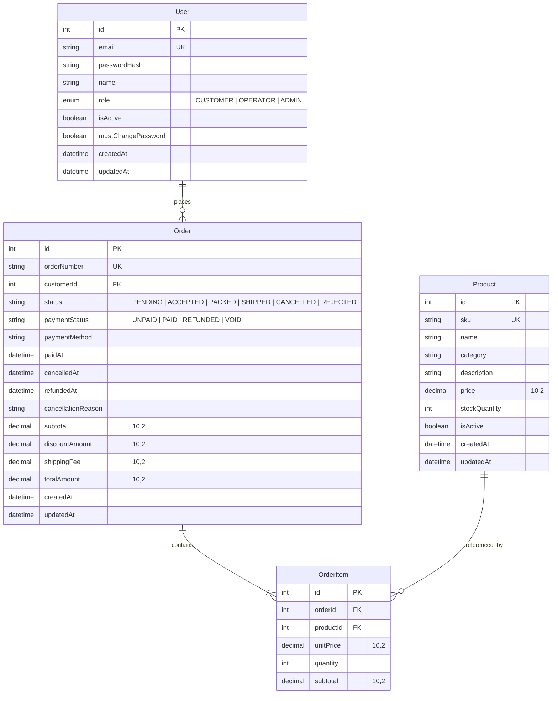
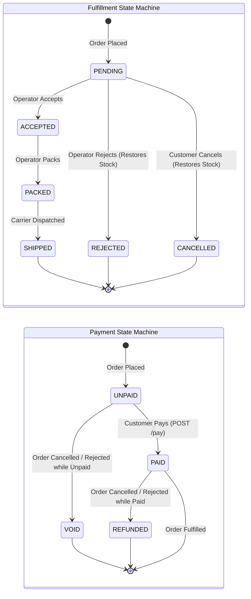

# System-Level Software Design Specification (SDS)

---

## 1. System Architecture & Component Decomposition

The TechTent platform is structured into three logical tiers adhering to strict separation of concerns across Sprint 1 and Sprint 2:

```
+---------------------------------------------------------------------------------+
|                               Presentation Tier                                 |
|                       React 18 SPA (Vite + TypeScript)                          |
|  - AppShell / Responsive Navbar (Brand: TechTent, Role Badges, Order Links)     |
|  - CatalogPage (Categorized Everyday Tech: Phones, TVs, Tablets, Keyboards)     |
|  - CartDrawer / OrderCheckout (Item Quantities, Subtotals, Instant Checkout)    |
|  - OrderHistoryPage & OrderDetailPage (Itemized Receipts, Preserved Prices)     |
|  - OrderActionModals: Cancel Order Modal, Simulated Payment Modal, Reject Dialog |
|  - OperatorOrdersPage (Queue Filter Bar, Order Cards, Accept/Pack/Ship Actions) |
|  - ManageProductsPage (/operator/products: CRUD, Soft Toggle, Restock, Sorting) |
|  - OperatorReportsPage (/operator/reports: Sales Summary, Turnaround Metrics)   |
|  - AuthContext & RoleGuard (Session hydration, Protected Route Guards)          |
+---------------------------------------------------------------------------------+
                                       │
                                       │ HTTP / JSON REST APIs (Cookies included)
                                       ▼
+---------------------------------------------------------------------------------+
|                              Application / API Tier                             |
|                             Express 4.21 + Node.js                              |
|  - Middleware: CORS, cookieParser, express-session, requireAuth, requireRole    |
|  - Centralized Error Envelope Middleware: standardizes { error: { code, msg } } |
|  - Auth Router: POST /login, POST /logout, GET /me, POST /change-password       |
|  - Catalog Router: GET /api/products, POST /api/products, PATCH /api/products/:id|
|    POST /api/products/:id/restock                                               |
|  - Orders Router: POST /api/orders, GET /api/orders, GET /api/orders/:id        |
|    POST /api/orders/:id/cancel, POST /api/orders/:id/pay                        |
|  - Operator Router: GET /api/operator/orders, PATCH /api/operator/orders/:id/status|
|  - Transactional Engine: Server-side pricing, atomic stock reservation/restoral |
+---------------------------------------------------------------------------------+
                                       │
                                       │ Prisma ORM 5.22 (Type-Safe Client)
                                       ▼
+---------------------------------------------------------------------------------+
|                               Persistence Tier                                  |
|                            PostgreSQL 16 Database                               |
|  - User (Credentials, Roles: CUSTOMER, OPERATOR, ADMIN, Account Flags)          |
|  - Product (SKU, Name, Category, Price, StockQuantity, IsActive)                |
|  - Order (OrderNumber, CustomerId, Status, PaymentStatus, TotalAmount,          |
|           PaidAt, CancelledAt, RefundedAt, CancellationReason, Timestamps)      |
|  - OrderItem (OrderId, ProductId, UnitPrice, Quantity, Subtotal)                |
+---------------------------------------------------------------------------------+
```

---

## 2. Data Architecture & Relational Schema

### 2.1 Entity Relationship Model


### 2.2 Complete Sprint 2 Prisma Schema Definition
```prisma
datasource db {
  provider = "postgresql"
  url      = env("DATABASE_URL")
}

generator client {
  provider = "prisma-client-js"
}

enum Role {
  CUSTOMER
  OPERATOR
  ADMIN
}

model User {
  id                 Int      @id @default(autoincrement())
  email              String   @unique
  passwordHash       String
  name               String
  role               Role     @default(CUSTOMER)
  isActive           Boolean  @default(true)
  mustChangePassword Boolean  @default(false)
  createdAt          DateTime @default(now())
  updatedAt          DateTime @updatedAt

  orders             Order[]
}

model Product {
  id            Int         @id @default(autoincrement())
  sku           String      @unique
  name          String
  category      String
  description   String?
  price         Decimal     @db.Decimal(10, 2)
  stockQuantity Int         @default(0)
  isActive      Boolean     @default(true)
  createdAt     DateTime    @default(now())
  updatedAt     DateTime    @updatedAt

  orderItems    OrderItem[]

  @@index([category, isActive])
}

model Order {
  id                 Int         @id @default(autoincrement())
  orderNumber        String      @unique
  customerId         Int
  customer           User        @relation(fields: [customerId], references: [id])
  status             String      @default("PENDING") // PENDING, ACCEPTED, PACKED, SHIPPED, CANCELLED, REJECTED
  paymentStatus      String      @default("UNPAID")  // UNPAID, PAID, REFUNDED, VOID
  paymentMethod      String?
  paidAt             DateTime?
  cancelledAt        DateTime?
  refundedAt         DateTime?
  cancellationReason String?
  totalAmount        Decimal     @db.Decimal(10, 2)
  createdAt          DateTime    @default(now())
  updatedAt          DateTime    @updatedAt

  items              OrderItem[]

  @@index([customerId, status])
  @@index([status, createdAt])
  @@index([paymentStatus])
}

model OrderItem {
  id        Int      @id @default(autoincrement())
  orderId   Int
  order     Order    @relation(fields: [orderId], references: [id], onDelete: Cascade)
  productId Int
  product   Product  @relation(fields: [productId], references: [id])
  unitPrice Decimal  @db.Decimal(10, 2) // Preserved purchase-time unit price
  quantity  Int
  subtotal  Decimal  @db.Decimal(10, 2)

  @@index([orderId])
  @@index([productId])
}
```

---

## 3. Order Lifecycle & Dual-Track State Machine

The TechTent ordering system operates two decoupled state machines:



---

## 4. Comprehensive Role-Based Access Control (RBAC) Matrix

| API Endpoint Path | HTTP Verb | Anonymous | `CUSTOMER` | `OPERATOR` | `ADMIN` | Record Ownership Enforcement |
|---|---|:---:|:---:|:---:|:---:|---|
| `/api/auth/login` | POST | Allow | Allow | Allow | Allow | None (Public) |
| `/api/auth/logout` | POST | 401 | Allow | Allow | Allow | None |
| `/api/auth/me` | GET | 401 | Allow | Allow | Allow | Current session user |
| `/api/products` (Active) | GET | Allow | Allow | Allow | Allow | Filtered: `isActive = true` |
| `/api/products` (Create) | POST | 401 | 403 | Allow | Allow | None |
| `/api/products/:id` (Edit) | PATCH | 401 | 403 | Allow | Allow | None |
| `/api/products/:id/restock` | POST | 401 | 403 | Allow | Allow | None |
| `/api/orders` (Checkout) | POST | 401 | Allow | 403 | 403 | Automatically bound to session user |
| `/api/orders` (History) | GET | 401 | Allow | 403 | Allow | Scoped: `customerId == session.userId` |
| `/api/orders/:id` (Receipt) | GET | 401 | Allow | Allow | Allow | Customers can only view their own orders |
| `/api/orders/:id/cancel` | POST | 401 | Allow | 403 | Allow | Customers can only cancel their own orders |
| `/api/orders/:id/pay` | POST | 401 | Allow | 403 | Allow | Customers can only pay for their own orders |
| `/api/operator/orders` | GET | 401 | 403 | Allow | Allow | Unrestricted across all customers |
| `/api/operator/orders/:id/status`| PATCH | 401 | 403 | Allow | Allow | None |
| `/api/reports/sales-summary` | GET | 401 | 403 | Allow | Allow | Operator & Admin Aggregate View |
| `/api/reports/turnaround` | GET | 401 | 403 | Allow | Allow | Operator & Admin Aggregate View |
| `/api/health` / `/api/ready` | GET | Allow | Allow | Allow | Allow | None (Public Probe) |

---

## 5. Sprint 3 Architectural Contracts & Specifications

### 5.1 F-09: Sales Reporting Engine & Operational Metrics (`FR-14`)

- **Objective**: Deliver authoritative store management intelligence for Operators and Administrators.
- **API Endpoints**:
  - `GET /api/reports/sales-summary`: Returns aggregated total revenue, total order count, average order value (AOV), and breakdown counts by status across optional query filters (`startDate`, `endDate`).
    - Response Envelope:
      ```json
      {
        "data": {
          "totalRevenue": "12845.50",
          "totalOrders": 42,
          "averageOrderValue": "305.85",
          "statusCounts": {
            "PENDING": 4,
            "ACCEPTED": 6,
            "PACKED": 8,
            "SHIPPED": 20,
            "CANCELLED": 2,
            "REJECTED": 2
          }
        }
      }
      ```
  - `GET /api/reports/turnaround`: Returns fulfillment turnaround performance metrics computed from order creation to final `SHIPPED` timestamps (average hours/minutes in `PENDING`, `ACCEPTED`, `PACKED`).
- **Data Access & Performance**:
  - Leverages PostgreSQL aggregate functions (`SUM`, `COUNT`, `AVG`) indexed over `Order(status, createdAt)` and `Order(paymentStatus)`.

### 5.2 F-10: Production Hardening, Rate Limiting & Error Sanitization (`FR-15`)

- **Objective**: Protect public attack surfaces and prevent server telemetry leakage.
- **Rate Limiting Middleware**:
  - `express-rate-limit` mounted on `/api/auth/login` (window: 15 minutes, max: 10 attempts per IP) returning `429 Too Many Requests`.
- **Error Envelope Sanitization**:
  - Enforce standard `{ error: { code: string, message: string } }` without exposing internal database stack traces or SQL error details in non-development environments.
