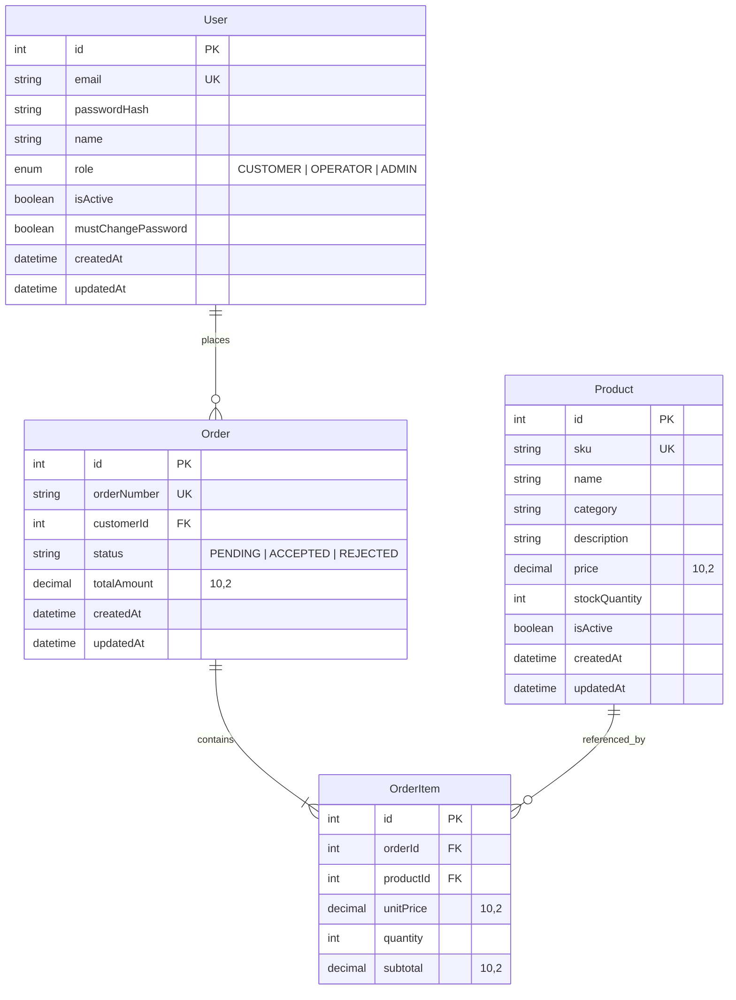

# System-Level Software Design Specification (SDS)

---

## 1. System Architecture & Component Decomposition

The system is organized into three logical tiers adhering to clean separation of concerns:

```
+---------------------------------------------------------------------------------+
|                               Presentation Tier                                 |
|                       React 18 SPA (Vite + TypeScript)                          |
|  - AppShell / Responsive Navbar (Brand: TechTent, Role Badges, Order Links)     |
|  - CatalogPage (Categorized Everyday Tech: Phones, TVs, Tablets, Keyboards)     |
|  - CartDrawer / OrderCheckout (Item Quantities, Subtotals, Instant Checkout)    |
|  - OrderHistoryPage & OrderDetailPage (Itemized Receipts, Preserved Prices)     |
|  - OperatorOrdersPage (Queue Filter Bar, Order Cards, Accept/Reject Actions)    |
|  - AuthContext & RoleGuard (Session hydration, Protected Navigation)           |
+---------------------------------------------------------------------------------+
                                       │
                                       │ HTTP / JSON REST APIs (Cookies included)
                                       ▼
+---------------------------------------------------------------------------------+
|                              Application / API Tier                             |
|                             Express 4.21 + Node.js                              |
|  - Middleware: CORS, cookieParser, express-session, requireAuth, requireRole    |
|  - Auth Router: POST /login, POST /logout, GET /me, POST /change-password       |
|  - Catalog Router: GET /api/products                                            |
|  - Orders Router: POST /api/orders, GET /api/orders, GET /api/orders/:id        |
|  - Operator Router: GET /api/operator/orders                                  |
|    PATCH /api/operator/orders/:id/status                                     |
|  - Authoritative Engine: Server-side pricing recalculation & transaction guard  |
+---------------------------------------------------------------------------------+
                                       │
                                       │ Prisma ORM 5.22 (Type-Safe Client)
                                       ▼
+---------------------------------------------------------------------------------+
|                               Persistence Tier                                  |
|                            PostgreSQL 15+ Database                              |
|  - User (Credentials, Roles: CUSTOMER, OPERATOR, ADMIN, Account Flags)          |
|  - Product (SKU, Name, Category, Price, StockQuantity, IsActive)                |
|  - Order (OrderNumber, CustomerId, Status, TotalAmount, Timestamps)             |
|  - OrderItem (OrderId, ProductId, UnitPrice, Quantity, Subtotal)                |
+---------------------------------------------------------------------------------+
```

### 1.1 Communication & Rule Enforcement Points
- **Client Tier**: Enforces immediate UI validation (positive integer inputs, non-empty carts) and provides responsive feedback. UI controls for unauthorized actions are hidden or disabled.
- **API Tier**: The single point of truth for all business rules.
  - Re-fetches current catalog unit prices directly from PostgreSQL for all submitted line items.
  - Executes order creation and stock decrements inside a strict database transaction (`prisma.$transaction`).
  - Verifies user role and record ownership before returning private data.
- **Database Tier**: Enforces referential integrity (foreign keys `customerId` ➔ `User.id`, `orderId` ➔ `Order.id`, `productId` ➔ `Product.id`), unique constraints on `email`, `sku`, and `orderNumber`, and non-null constraints.

---

## 2. Data Architecture & Relational Schema

### 2.1 Entity Relationship Model


### 2.2 Complete Prisma Schema Definition
```prisma
datasource db {
  provider = "postgresql"
  url      = env("DATABASE_URL")
}

generator client {
  provider = "prisma-client-js"
}

enum Role {
  CUSTOMER
  OPERATOR
  ADMIN
}

model User {
  id                 Int      @id @default(autoincrement())
  email              String   @unique
  passwordHash       String
  name               String
  role               Role     @default(CUSTOMER)
  isActive           Boolean  @default(true)
  mustChangePassword Boolean  @default(false)
  createdAt          DateTime @default(now())
  updatedAt          DateTime @updatedAt

  orders             Order[]
}

model Product {
  id            Int         @id @default(autoincrement())
  sku           String      @unique
  name          String
  category      String
  description   String?
  price         Decimal     @db.Decimal(10, 2)
  stockQuantity Int         @default(0)
  isActive      Boolean     @default(true)
  createdAt     DateTime    @default(now())
  updatedAt     DateTime    @updatedAt

  orderItems    OrderItem[]

  @@index([category, isActive])
}

model Order {
  id          Int         @id @default(autoincrement())
  orderNumber String      @unique
  customerId  Int
  customer    User        @relation(fields: [customerId], references: [id])
  status      String      @default("PENDING") // PENDING, ACCEPTED, REJECTED
  totalAmount Decimal     @db.Decimal(10, 2)
  createdAt   DateTime    @default(now())
  updatedAt   DateTime    @updatedAt

  items       OrderItem[]

  @@index([customerId, status])
  @@index([status, createdAt])
}

model OrderItem {
  id        Int      @id @default(autoincrement())
  orderId   Int
  order     Order    @relation(fields: [orderId], references: [id], onDelete: Cascade)
  productId Int
  product   Product  @relation(fields: [productId], references: [id])
  unitPrice Decimal  @db.Decimal(10, 2) // Preserved purchase-time unit price
  quantity  Int
  subtotal  Decimal  @db.Decimal(10, 2)

  @@index([orderId])
  @@index([productId])
}
```

---

## 3. UI Navigation & Component Conventions

### 3.1 Main Navigation Structure
- **Global Header**:
  - Store Logo / Brand: "⛺ TechTent" (links to `/` catalog).
  - Navigation links dynamically rendered by role:
    - **Guest**: Catalog (`/`), Sign In (`/login`).
    - **Customer**: Catalog (`/`), My Orders (`/orders`), User Profile / Sign Out.
    - **Operator / Admin**: Catalog (`/`), Operator Queue (`/operator/orders`), User Profile / Sign Out.
  - Active visual indicator on the current route.
  - Role pill badges in header (`Customer`, `Operator`, `Admin`).

### 3.2 Shared Component Behavior & States
- **Loading State**: Clean spinner / skeleton placeholder during async data fetch.
- **Empty State**: Friendly illustration and message when lists are empty (e.g., *"No past orders found. Browse our catalog to place your first order."*).
- **Error State**: Informative banner displaying server error code and user-friendly explanation with a "Retry" button.
- **Validation Feedback**: Inline red helper text on invalid form inputs (e.g., *"Quantity must be at least 1"* or *"Insufficient stock available"*).

---

## 4. API Architecture & Security Conventions

### 4.1 Endpoint Conventions & Formats
- Base URL: `/api`
- All request/response payloads are UTF-8 JSON.
- **Standard Success Response Format**:
  ```json
  {
    "data": { ... }
  }
  ```
- **Standard Error Response Format**:
  ```json
  {
    "error": {
      "code": "INSUFFICIENT_STOCK",
      "message": "Product 'Pro Smartphone 256GB' only has 2 units remaining."
    }
  }
  ```

### 4.2 Standard HTTP Status Codes
| HTTP Status | Meaning | Typical Usage in TechTent |
|---|---|---|
| `200 OK` | Request succeeded | Successful GET, PATCH, or session retrieval |
| `201 Created` | Resource created | Order successfully placed (`POST /api/orders`) |
| `400 Bad Request` | Invalid payload / syntax | Missing fields, non-integer quantity, empty cart |
| `401 Unauthorized` | Missing / invalid session | Not logged in, expired cookie |
| `403 Forbidden` | Access denied | Customer accessing operator queue or another's order |
| `404 Not Found` | Resource not found | Invalid product ID or non-existent order |
| `409 Conflict` | Business rule conflict | Insufficient stock, invalid order state transition |
| `500 Internal Error`| Unhandled server crash | Database disconnection, unexpected exception |

### 4.3 Role-Based Authorization Matrix

| Method | Path | Target Resource | Public / Guest | Customer | Operator | Admin |
|---|---|---|---|---|---|---|
| `GET` | `/api/health` | Service health status | Allow | Allow | Allow | Allow |
| `POST` | `/api/auth/login` | Session login | Allow | Allow | Allow | Allow |
| `POST` | `/api/auth/logout` | Session teardown | 401 | Allow | Allow | Allow |
| `GET` | `/api/auth/me` | Current session user | 401 | Allow | Allow | Allow |
| `POST` | `/api/auth/change-password` | Password change | 401 | Allow | Allow | Allow |
| `GET` | `/api/products` | Active electronics catalog | Allow | Allow | Allow | Allow |
| `POST` | `/api/orders` | Place multi-item order | 401 | Allow | 403 | 403 |
| `GET` | `/api/orders` | Customer's own order list | 401 | Own Only | 403 | 403 |
| `GET` | `/api/orders/:id` | Itemized order receipt | 401 | Own Only (403) | Allow | Allow |
| `GET` | `/api/operator/orders` | Operational order queue | 401 | 403 | Allow | Allow |
| `PATCH`| `/api/operator/orders/:id/status` | Accept/Reject order | 401 | 403 | Allow | Allow |

---

## 5. Security & Session Lifecycle

1. **Authentication Session Management**:
   - Backed by `express-session` with signed cookies stored in HTTP-only cookies (`connect.sid`).
   - Cookie settings: `httpOnly: true`, `sameSite: "lax"`, `maxAge: 24 * 60 * 60 * 1000` (24 hours).
2. **Password Security**:
   - `bcryptjs` hashing with 10 salt rounds.
   - Enforced complexity: minimum 8 characters, >= 1 uppercase letter, >= 1 lowercase letter, >= 1 numerical digit.
3. **Session Teardown & Logout**:
   - `POST /api/auth/logout` destroys the backend session record and clears the client's `connect.sid` cookie.
4. **Data Isolation (Anti-Tampering)**:
   - Order totals, subtotals, and unit prices submitted in client request bodies are completely ignored.
   - All financial numbers are calculated using current catalog database records at execution time.

---

## 6. Configuration & Deployment Plan

- **Local Execution**: Externalized configuration via `server/.env` (`PORT`, `DATABASE_URL`, `SESSION_SECRET`).
- **Containerization Readiness (Lab 5 Alignment)**:
  - Multi-stage Docker packaging separating client Vite static build from Express Node.js runner.
  - Production static serving or reverse proxy for frontend assets.
  - Cloud SQL PostgreSQL connectivity compatible with Google Cloud Run.

## 7. Implemented Feature 5 Fulfillment Design

`server/src/app.ts` exposes `GET /api/operator/orders` and
`PATCH /api/operator/orders/:id/status`. The operator service lives in
`server/src/services/operatorOrders.ts`; no new schema or library is required.

Both endpoints authenticate, refresh/enforce password policy, then require
`OPERATOR` or `ADMIN`. Queue queries select only permitted customer and item
fields, filter in the database, and sort by placement date/ID descending. Stored
Decimal prices/totals are serialized directly to two-decimal strings.

Status processing uses a Prisma `ReadCommitted` transaction. Its first write
conditionally updates the requested order only if status is `PENDING`. Affected
row count must be one before inventory restoration. PostgreSQL's row lock and
predicate recheck serialize competing updates to that order. Acceptance touches
no inventory; rejection increments each stored quantity in stable product-ID
order. All writes roll back on any failure. P2034 errors retry the complete
aborted transaction up to three attempts; individual increments are never retried
outside the transaction. Terminal orders return a conflict without further writes.

The frontend uses existing routing, auth, API and currency helpers. Query-string
filters survive queue refresh and receipt round trips. The native rejection
dialog provides a name/description and focus handling. UI controls prevent
accidental duplicate submission; correctness still rests on the backend claim.

Real PostgreSQL concurrency and post-write rollback tests passed. Native browser
dialog behavior and responsive visual rendering remain unverified. This design
does not repair the separate inherited customer-checkout concurrency defects.
See [the integration review](sprints/sprint-1/f05-integration-review.md).
